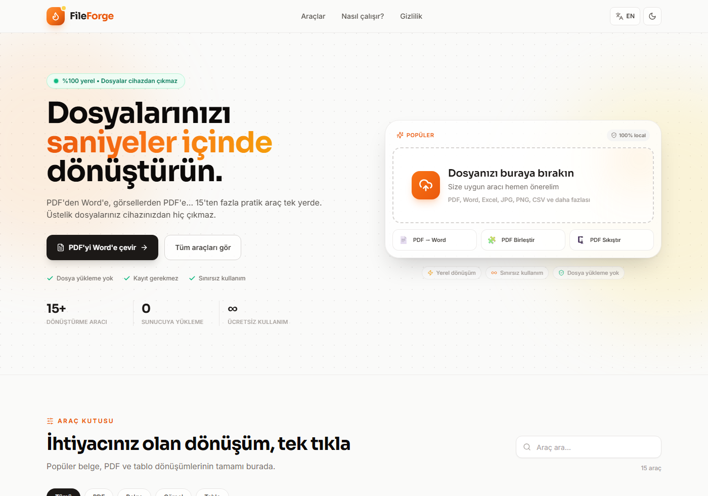

# FileForge

**Dosyalarınızı saniyeler içinde dönüştürün — tamamen tarayıcınızda.**

FileForge, dosya dönüştürme işlemlerini sunucuya hiçbir şey yüklemeden, doğrudan
tarayıcının içinde çalıştıran yerel öncelikli (local-first) bir web uygulamasıdır.
PDF'den Word'e dönüştürme başta olmak üzere günlük hayatta en çok ihtiyaç duyulan
15 dönüştürme aracını tek bir arayüzde toplar. Türkçe ve İngilizce arayüz desteği,
açık/koyu tema ve sürükle-bırak dosya yükleme sunar.

> Dosyalarınız cihazınızdan çıkmaz. Uygulama tamamen istemci tarafında çalışır;
> hiçbir dosya bir sunucuya yüklenmez, kaydedilmez veya üçüncü taraflarla paylaşılmaz.



## Araçlar

| Kategori | Araçlar |
| --- | --- |
| PDF | PDF → Word, PDF → JPG, PDF → PNG, PDF → Metin, PDF → Excel, PDF Birleştir, PDF Böl, PDF Döndür, PDF Sıkıştır |
| Belge | Word → PDF, Metin → PDF |
| Görsel | Görsel → PDF (JPG, PNG, WebP) |
| Tablo | Excel → CSV, CSV → Excel, Excel → PDF |

### Öne çıkan özellikler

- **PDF → Word:** Metin, paragraf ve başlık algılama ile düzenlenebilir `.docx` çıktısı.
  "Görünümü koru" açıkken metin, PDF'deki konumuna yerleştirilir; CV gibi
  belgelerde sayfa düzeni korunur.
- **Sayfa aralığı:** `1-3,5,8-` gibi seçimlerle yalnızca istediğiniz sayfaları işleyin.
- **Çoklu dosya:** Birleştirme ve toplu dönüştürmede dosya sırasını değiştirin.
- **ZIP indirme:** Birden fazla çıktıyı tek arşivde indirin.
- **Gizlilik:** Tüm işlemler tarayıcıda; ağ isteği yok.
- **Türkçe / İngilizce:** Tek tıkla dil değişimi, tercih `localStorage`'da saklanır.
- **Karanlık mod:** Sistem tercihine saygı duyar, kullanıcı seçimini hatırlar.

## İndirip çalıştırma (Windows)

Başka bir bilgisayarda kullanmak için GitHub sayfasındaki **Code → Download ZIP**
ile projeyi indirin, ZIP dosyasını bir klasöre çıkarın ve klasördeki
**`setup.cmd`** dosyasına çift tıklayın. Kurulum betiği:

1. Node.js 18+ kurulu mu diye kontrol eder (değilse [nodejs.org](https://nodejs.org) adresini gösterir),
2. `frontend` bağımlılıklarını kurar,
3. üretim derlemesini oluşturur,
4. masaüstüne **FileForge** kısayolunu ekler.

Kurulum bittikten sonra masaüstündeki **FileForge** simgesine çift tıklamanız
yeterlidir. Uygulama tarayıcıda ayrı bir pencerede açılır ve pencere kapanınca
arka plandaki yerel sunucu da kapanır.

> Node.js kurulu değilse `setup.cmd` sizi uyarır. Node.js'i kurduktan sonra
> `setup.cmd` dosyasını yeniden çalıştırmanız gerekir.

### Geliştirme

Gereksinimler: Node.js 18+ ve npm.

```bash
cd frontend
npm install
npm run dev
```

Geliştirme sunucusu varsayılan olarak <http://localhost:5173> adresinde açılır.

### Üretim derlemesi

```bash
cd frontend
npm run build     # tip kontrolü + vite build
npm run preview   # derlenmiş uygulamayı önizle
```

`dist/` klasörü statik olarak herhangi bir hosting üzerinde yayınlanabilir.
Uygulamanın çalışması için backend, veritabanı veya API anahtarı gerekmez.

### Uygulama gibi başlatma

Masaüstündeki **FileForge** kısayoluna çift tıklamak yeterlidir. Kısayol,
`launcher/FileForge.vbs` üzerinden `frontend/scripts/launch.mjs` betiğini
çalıştırır. Betik:

1. Gerekirse üretim derlemesini yeniler (`dist/` yoksa veya kaynaklar daha yeniyse),
2. Uygulamayı yalnızca `127.0.0.1` üzerinde rastgele boş bir portta sunar,
3. Chrome/Edge'yi ayrı bir profil ve uygulama penceresiyle açar,
4. Pencere kapanınca yerel sunucuyu da kapatır.

Terminalden aynı şekilde başlatmak için:

```bash
cd frontend
npm run app
```

Kısayol proje klasörünün mutlak yolunu kullanır. Klasörü taşırsanız kısayolu
yeniden oluşturmanız gerekir. Node.js kurulu değilse uygulama açılmaz.

### Tip kontrolü

```bash
cd frontend
npm run typecheck
```

## Teknoloji

- **React 18 + TypeScript + Vite 4**
- **Tailwind CSS** — tasarım sistemi, açık/koyu tema
- **pdfjs-dist** — PDF metin çıkarma ve sayfa görüntüleme
- **pdf-lib + fontkit** — PDF oluşturma, birleştirme, bölme, döndürme, sıkıştırma
- **docx** — Word belgesi oluşturma
- **mammoth + html2canvas + jsPDF** — Word → PDF
- **xlsx** — Excel/CSV dönüşümleri
- **JSZip** — toplu indirme
- **lucide-react** — ikonlar

Ağır dönüştürme kütüphaneleri yalnızca ilgili araç kullanıldığında dinamik olarak
yüklenir; ilk açılış hızlı kalır.

## Proje yapısı

```
frontend/
  src/
    components/       # Arayüz bileşenleri (Hero, ToolGrid, Workspace, ...)
    lib/              # Dönüştürme motorları
      pdf.ts          # PDF okuma, metin/tablo çıkarma, görüntüleme, birleştirme...
      pdfToDocx.ts    # PDF → Word
      docxToPdf.ts    # Word → PDF
      spreadsheet.ts  # Excel / CSV / PDF tablo dönüşümleri
      imageTools.ts   # Görsel → PDF
      text.ts         # Metin → PDF, PDF → Metin
      files.ts        # Dosya adı, indirme, ZIP, sayfa aralığı yardımcıları
    tools/
      definitions.ts  # Araç tanımları ve seçenekler
      runTool.ts      # Dönüştürme yönlendiricisi (lazy import)
    i18n.tsx          # Türkçe / İngilizce metinler
    App.tsx
  scripts/            # Yerel sunucu ve uygulama başlatıcı
  index.html
launcher/             # Windows kısayol başlatıcısı ve uygulama ikonu
```

## Bilinen sınırlar

- **PDF → Word** metin tabanlı PDF'ler için tasarlanmıştır. Taranmış (görüntü
  tabanlı) PDF'lerde seçilebilir metin olmadığı için OCR gerektiğini belirten bir
  uyarı gösterilir. "Görünümü koru" modu metni orijinal koordinatlarına
  yerleştirir; ancak fotoğraflar, vektör çizgiler, arka plan renkleri ve tam yazı
  tipi eşleşmesi Word belgesine aktarılmaz. Bu öğeler gerekiyorsa PDF'i
  düzenlenebilir bir vektör belgeye dönüştürmek yerine görüntü olarak kullanmak
  gerekir. "Görünümü koru" kapatıldığında akıcı, düzenlenebilir düz metin üretilir.
- **Word → PDF** ve **Excel → PDF** çıktıları tarayıcıda rasterize edilir. Bu,
  her ortamda tutarlı görünüm sağlar ancak çok büyük belgelerde dosya boyutu
  artabilir.
- **PDF Sıkıştır** yeniden örnekleme yapar. Sonuç orijinalden büyük olursa
  orijinal dosya korunur.
- Tarayıcı belleği nedeniyle çok büyük dosyalarda (özellikle 100 MB üzeri)
  performans düşebilir. Uygulama 100 MB üzerindeki dosyaları reddeder.

## Lisans

Bu proje **MIT Lisansı** ile açık kaynak olarak yayınlanmıştır. Ayrıntılar için
[`LICENSE`](LICENSE) dosyasına bakın. Kullanılan açık kaynak kütüphanelerin
lisansları kendi paketlerinde belirtilmiştir.
